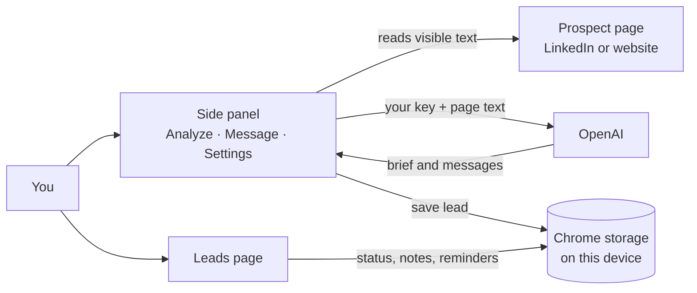
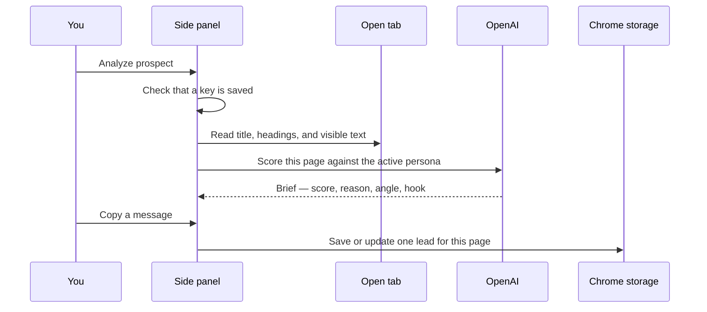
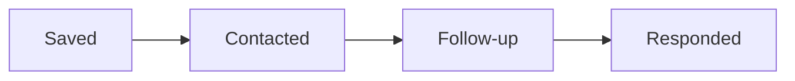
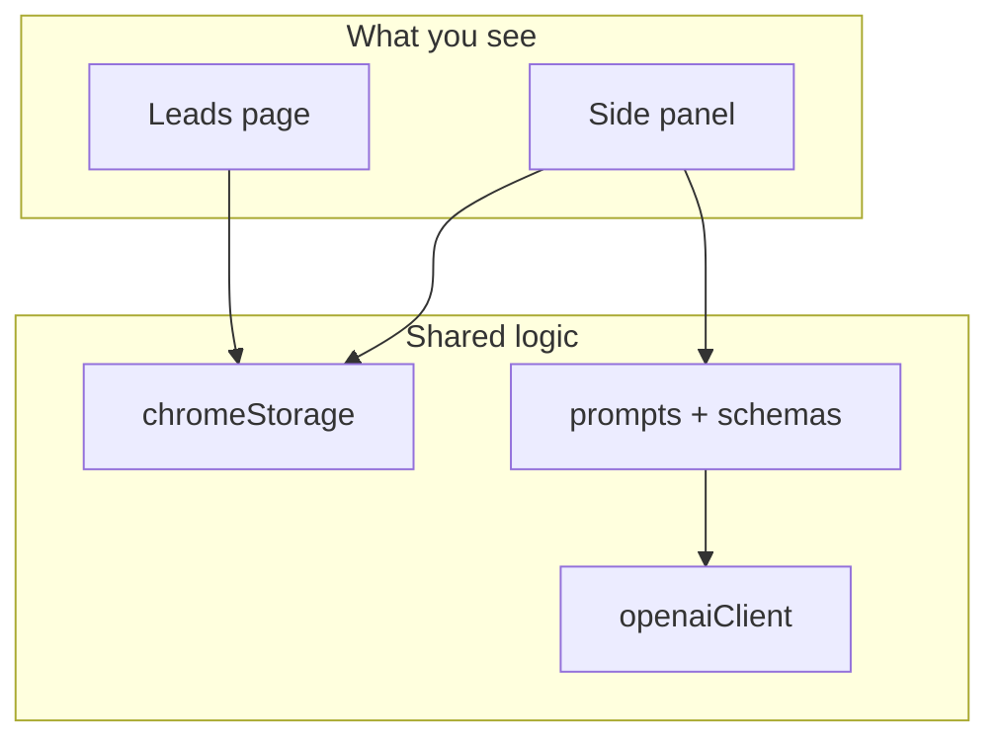

# LeadBrief AI — how it is built

This is a map of the extension. For install steps and day-to-day use, start with the [README](../README.md).

LeadBrief is a Chrome extension. It reads the page you are looking at, asks OpenAI for a short brief and a few outreach lines, and stores the lead on your computer. There is no LeadBrief server.

## The picture



Three places are involved, and only two of them ever see your data:

| Place | What it holds |
| --- | --- |
| Your browser | Leads, personas, messages, notes, and your OpenAI key |
| OpenAI | The page text for the request you just made. Billed to your OpenAI account |
| This repository | The extension code. No API key, no leads |

## What happens when you analyze someone



Re-analyzing the same page updates that lead. It does not create a second card.

## A lead, from first look to reply

You can set any of these from the lead's detail panel. The highlighted button is the current one.



A follow-up date is a calendar day on your machine. The lead shows as **due** on that day, not the morning after. Copying a new message will not move a lead backward: once it is **Responded**, saving again keeps that status and refreshes the brief.

Same page + same persona = one lead. `www`, a trailing slash, and `?query` do not count as a different page.

## Features

| Feature | What you do | Status |
| --- | --- | --- |
| Analyze | Open a normal website tab and click **Analyze prospect** | Works |
| Fit score | Read the score, recommendation, signals, angle, and hook | Works |
| Headings | Page headings are sent with the visible text so titles are not dropped | Works |
| Three messages | Generate professional, casual, and subtle versions | Works |
| Your own draft | Edit, fix grammar, or improve slightly, then copy | Works |
| API key gate | Analyze and message buttons stay off until a key is saved | Works |
| Copy feedback | If Chrome blocks the clipboard, the toast says so. The lead is still saved | Works |
| Personas | Separate criteria and a separate lead list for each persona | Works |
| Delete a persona | Its leads move to the persona you keep. Unsaved settings stay unsaved | Works |
| Leads page | Search, filter, set any of the four statuses, add a note, delete | Works |
| Follow-up | Pick a date. **Due now** lists reminders for today or earlier | Works |
| Dedupe | One card per page inside a persona | Works |
| Privacy | Data stays in Chrome. Page text goes only to OpenAI, with your key | Works |
| Store icons | 16 / 48 / 128 PNG icons are not in the manifest yet | Not in this build |
| Live browser test | Automated tests do not open Chrome or spend API credit | Covered by hand, see README |

## Where the code lives

```text
src/sidepanel/     the panel you open from the toolbar
  SidePanelApp     Analyze, Message, Settings, and saving a lead
  extractInPage    reads the open tab. Runs inside that tab
src/leads/         the full-page lead list
src/components/    brief, messages, settings form, shared buttons
src/lib/
  chromeStorage    load, save, dedupe, persona move
  openaiClient     one call to api.openai.com
  prompts          what we ask the model
  schemas          the shape the model must return
  dates            follow-up days, in local time
  apiAccess        is a key saved?
src/background/    opens the side panel when you click the icon
manifest.json      permissions Chrome asks for
```



## Rules the code keeps

- The OpenAI key is a field the user types in Settings. Prompts are not allowed to include it. A test checks that.
- A missing or blank key blocks Analyze, Generate, Fix grammar, and Improve slightly.
- Deleting a persona writes only that change. A half-edited API key or sender name stays in the form until **Save settings**.
- Two leads for the same URL are merged when a persona is deleted. Notes from both are kept. The further-along status wins.
- `npm test` checks those rules without Chrome and without OpenAI. `npm run package` runs the tests before it builds the zip.
